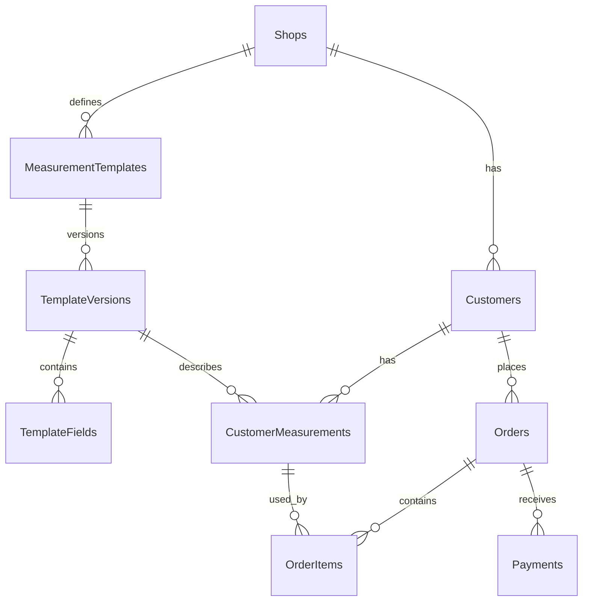

# Tailor Master

Offline-first tailoring management built with Expo SDK 58, React Native, TypeScript and SQLite. The normal app opens the existing `tailor-master.db` database; records are not reset on restart.

## What the app does

Tailor Master helps a tailoring shop keep customer details, garment measurements, orders and payments together on one device. It works offline and keeps records between sessions. You can organize multiple shops locally, customize measurement templates, check outstanding balances, produce receipts and make encrypted shop backups. See [Common workflows](#common-workflows) for a step-by-step introduction.

## Install and run

### Prerequisites

- Node.js 24 and npm. If you use a Node version manager, select the version in `.nvmrc` (for example, run `nvm use`).
- A terminal in the project directory and an internet connection to install dependencies.
- For a mobile preview, a compatible Expo client and a connected device or emulator. Native features and printing should be checked on the intended device.

### Install dependencies

From the project root, install the versions recorded in the lockfile:

```sh
npm ci
```

Use `npm install` when intentionally updating the dependency tree. To add an Expo or React Native package, use `npx expo install <package>` so Expo can select an SDK-compatible version.

### Start the app

```sh
npm start
```

Follow the terminal prompts to open the app on a device, emulator or simulator. For a browser preview, use:

```sh
npm start -- --web --port 8081
```

Open `http://localhost:8081/` if it does not open automatically. Keep using the same browser and address: browser storage is separate for different origins and browsers. The SQLite web preview needs a single active tab per origin; a duplicate-tab lock is shown as a recovery error, never a fresh setup. Android builds use device-local SQLite and still need physical-device validation. To create an installable Android preview APK, see [Cloud builds](#cloud-builds).

### First use

1. Open the app, complete onboarding and create or select a shop.
2. Review the shop's currency and measurement unit in settings.
3. Add a customer, choose a garment template and save measurements.
4. Create an order for the customer, enter the items, delivery date and total, then record any advance.
5. Return to the order to track its status, record payments and view its receipt. Use the backup screen to make an encrypted copy of shop data.

## Features

- Heritage sewing-machine logo, stitched accents, ivory/green default and persistent Indigo/Rose app themes.
- English/Urdu interface and RTL; other selectable languages currently fall back to English.
- Shop onboarding, profile/logo/currency/unit settings, saved-shop selection and device-local language/theme settings.
- Customer creation/edit/search/archive, immutable measurement history and explicit measurement units.
- System templates, custom fields, eight field types, ordering and immutable template versions.
- Multi-item orders, delivery dates, statuses, exact minor-unit amounts, advances/payments and balances.
- Receipt preview and print/PDF/share support; native APIs require device QA.
- Password-encrypted logical shop backup with assets; validated same-shop restore with confirmation and atomic replacement.
- Atomic SQLite writes, foreign keys, indexes, migrations, legacy prototype import and local change outbox.

Secure LAN synchronization/pairing, permissions, complete reviewed translations, full SQLite-file backup and pilot/device/performance hardening remain incomplete. See [PRD](docs/PRD.md), [implementation plan](docs/IMPLEMENTATION.md) and [Android handoff](docs/ANDROID-TESTING.md).

## Test fixtures

`fixtures/customers.json` contains 10 male and 7 female synthetic customers. `fixtures/test-workshop.json` includes those customers, measurements, templates and 50 orders. See `fixtures/README.md`. The development-only `/test-data` screen can add the repeat-safe scenario without changing existing records.

## Tutorial recording instance

```sh
EXPO_PUBLIC_DEMO_MODE=1 npm start -- --web --localhost --port 8082
```

This explicitly labeled practice instance uses `tailor-master-walkthrough.db` on the separate 8082 origin and skips legacy import. It never selects the demo database in a native build or the normal 8081 preview. Do not confuse its empty practice shop with the normal shop.

## Verify

```sh
npm run typecheck
npm run lint
npm test
npx expo export --platform android
```

Tests run on Node.js 24 using its built-in test runner and real SQLite. Browser/manual checks supplement these tests; they do not prove Android behavior. Startup evidence and remaining browser limitations are documented in `docs/STARTUP-VERIFICATION.md`.

The annotated Hindi-narrated walkthrough is generated from actual app captures in `artifacts/walkthrough`. `scripts/render_walkthrough.py` requires Pillow, imageio-ffmpeg and macOS's Hindi Lekha voice. The narration is synthetic. Full-screen captures and resulting video are local artifacts, not uploads to a third-party service.

## App screens

Routes are in `src/app/` and use Expo Router. The main screens are:

| Area | Screens and purpose |
| --- | --- |
| Getting started | Onboarding, shop selection and dashboard (`onboarding`, `shops`, `index`) |
| Customers | Customer list, search, profile and edit (`customers`, `customer-search`, `customer`, `customer-edit`) |
| Measurements | Measurement entry and comparison (`measurement`, `measurement-compare`) |
| Templates | Browse and edit garment measurement templates (`templates`, `template-edit`) |
| Orders | List, detail and create/edit orders (`orders`, `order`, `order-edit`) |
| Payments and output | Order payment details and receipt preview (`order`, `receipt`) |
| Administration | Reports, settings, backup, devices and guide (`reports`, `settings`, `backup`, `devices`, `guide`) |
| Development | Synthetic scenario data (`test-data`, development only) |

## Common workflows

1. **Set up a shop:** Complete onboarding, select the shop and configure its currency, measurement unit and other details in settings.
2. **Record measurements:** Add or find a customer, choose a garment template, enter measurements and save. New measurement records preserve the earlier history.
3. **Create an order:** Select a customer and measurements, add one or more garment items, set the delivery date and total, and save. Update the status as work progresses.
4. **Collect payment:** Record an advance or later payment on the order. The remaining balance is calculated from the total and recorded payments. Open the receipt for print, PDF or sharing where supported.
5. **Customize a template:** Edit a template and its fields. Saved measurements continue to reference their original template version.
6. **Back up a shop:** Create a password-encrypted logical backup from the backup screen. Restore validates the backup and asks for confirmation before replacing data for the same shop. Keep the password and backup file safe.

## Database design

The app stores workshop data locally in SQLite. The normal database is `tailor-master.db`; the browser preview uses storage associated with its browser and origin. Shop-owned records are scoped by shop, while device preferences are stored separately. Foreign keys, indexes, transactions and application validation protect relationships and writes.



Measurements and template versions retain historical context. Money is stored in minor units, and payments are separate records. Full domain records are stored as JSON alongside selected indexed and constrained columns. A local change queue exists, but synchronization between devices is not implemented. See the [database ERD](docs/DATABASE-ERD.md) for the complete schema, constraints and enforcement boundaries.

## Expo command reference

Run these from the project root after `npm install`:

```sh
npx expo start                    # Start the development server
npx expo start --web              # Open the web preview
npx expo start --clear            # Clear the Metro cache and start
npx expo start --android          # Open on a connected Android device/emulator
npx expo start --ios              # Open on an iOS simulator (macOS)
npx expo install <package>       # Install an SDK-compatible package
npx expo install --check         # Check package compatibility
npx expo install --fix           # Update incompatible packages
npx expo-doctor                  # Diagnose project configuration/dependencies
npx expo lint                    # Run Expo lint
npx expo export --platform android # Export the Android bundle for verification
```

`expo start --android` and `--ios` require a suitable device or simulator and client. Expo Go contains only its bundled native modules; adding other native libraries requires a development build. Local `npx expo run:android` and `npx expo run:ios` require the relevant native toolchain. The project uses Continuous Native Generation: configure native behavior through `app.json` and config plugins rather than editing generated `android/` or `ios/` directories. See the [Expo SDK 58 reference](https://docs.expo.dev/versions/v58.0.0/) and [Expo CLI reference](https://docs.expo.dev/more/expo-cli/).

### Cloud builds

The checked-in `preview` profile in `eas.json` produces an Android APK for internal distribution. With an appropriately authorized Expo account and project access:

```sh
npx eas-cli@latest login
npx eas-cli@latest build --platform android --profile preview
npx eas-cli@latest build:list
```

Build credentials and account access may be required. Other build profiles and submission settings must be configured before using them. See the [Expo build documentation](https://docs.expo.dev/build/introduction/).

## Project layout

- `src/app/` — screens and navigation layouts.
- `src/components/` — shared interface components.
- `src/domain/` — models, validation and business rules.
- `src/database/` — SQLite schema, connection, migrations and repository.
- `src/services/` — backup, receipt, printing and platform-specific services.
- `src/localization/` — language strings and localization helpers.
- `tests/` and `fixtures/` — automated tests and synthetic data.
- `docs/` — design, implementation and verification notes.
- `artifacts/` — generated local test and walkthrough output; ignored by Git.

Keep `package-lock.json` in version control for reproducible installs. Dependencies in `node_modules/`, generated native directories, build outputs and local artifacts are ignored. Avoid committing real customer data, private keys or backup files.
