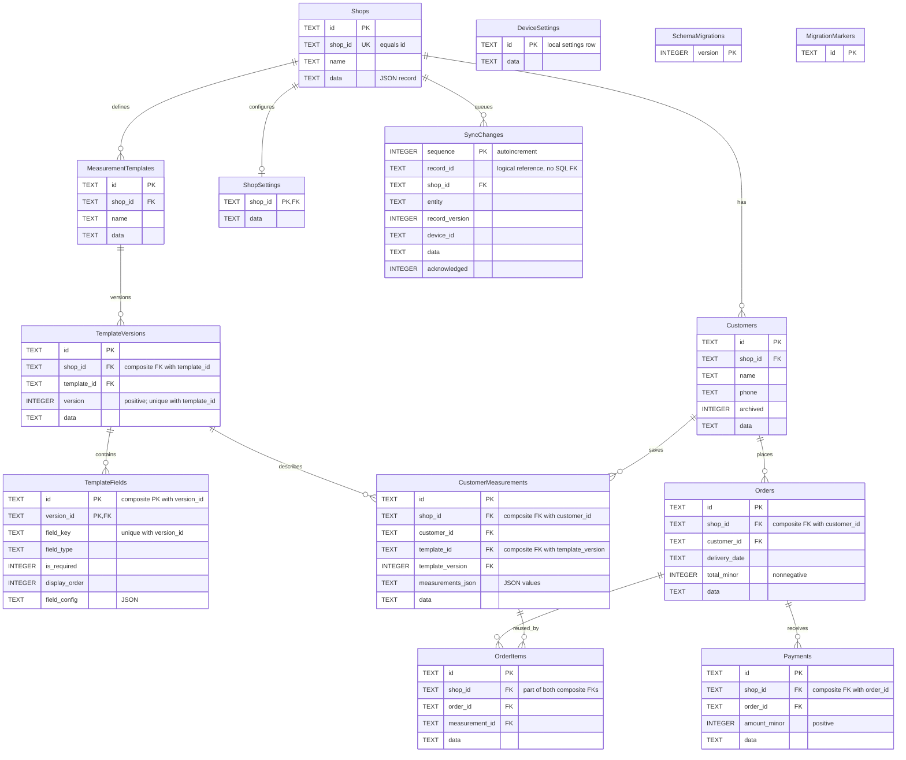

# Tailor Master — current database ERD

Verified against `src/database/schema.ts`, `src/database/repository.ts`, and `src/domain/model.ts` on 31 October 2026. This documents the existing SQLite schema, not proposed future changes. Standalone Mermaid source: [database-erd.mmd](database-erd.mmd).

## How to read it

`||` means exactly one parent; `o{` means zero or more children; `o|` means zero or one child. Cardinalities reflect SQL constraints. Application validation additionally requires each saved order to have at least one item. A measurement may be reused in many order items, including items belonging to different orders.

## Composite constraints

- Customers and MeasurementTemplates: `UNIQUE(id, shop_id)`.
- TemplateVersions: `UNIQUE(template_id, version)`; `(template_id, shop_id)` references MeasurementTemplates.
- TemplateFields: `PRIMARY KEY(id, version_id)` and `UNIQUE(version_id, field_key)`.
- CustomerMeasurements: `UNIQUE(id, shop_id)`; `(customer_id, shop_id)` references Customers; `(template_id, template_version)` references TemplateVersions.
- Orders: `UNIQUE(id, shop_id)`; `(customer_id, shop_id)` references Customers.
- OrderItems: `(order_id, shop_id)` references Orders and `(measurement_id, shop_id)` references CustomerMeasurements.
- Payments: `(order_id, shop_id)` references Orders.
- Shops: `shop_id` is unique and must equal `id`.

## What lives in JSON

The `data` column holds the full domain record. Some fields are also projected into SQL columns for constraints/indexes. The repository currently reads full JSON records and validates them in application code.

| Record | Examples stored inside JSON rather than dedicated SQL columns |
| --- | --- |
| Shops | ownerName, address, phone, logoPath, currency, defaultUnit, setupComplete |
| MeasurementTemplates | localized labels, systemKey, activeVersion, isActive |
| TemplateVersions | full field definitions |
| CustomerMeasurements | units and full measurement metadata |
| Orders | orderNumber, status, currency, instructions, archived |
| OrderItems | garment, quantity |
| Payments | payment metadata, including createdAt |
| ShopSettings | currency and defaultUnit, also present in the Shop record |
| DeviceSettings | deviceId, language, activeShopId, theme |

Domain records also include createdAt, updatedAt, recordVersion, deviceId, and archived. Device language is a device preference; it is not a separate per-shop language column. Advance payments are Payment records, not an AdvanceAmount column on Orders. Remaining balance is calculated from order total minus recorded payments.

## Important enforcement boundaries

- The SQL measurement-to-template-version relation does **not** include shop_id. Application validation checks the template version belongs to the same shop.
- SQL guarantees an OrderItem's order and measurement share a shop. Application validation additionally checks they belong to the same customer.
- Order-number uniqueness per shop, valid status/quantity/date, and prevention of overpayment are enforced by application validation, not dedicated SQL constraints for all of these rules.
- Historical measurements, template versions, order items and payments are immutable through the repository; this is not implemented with SQL triggers.
- DeviceSettings.activeShopId and SyncChanges.record_id are JSON/logical references, not additional SQL foreign keys. The three standalone settings/migration tables deliberately have no relationship lines beyond actual SQL FKs.
- SyncChanges is a local change queue; its presence does not mean device synchronization is implemented.
- SQLite schema version is currently 1; the serialized Workshop format uses schemaVersion 2. These are separate version numbers.

## Existing indexes

- Customers: `(shop_id, archived, name COLLATE NOCASE)` and `(shop_id, phone)`.
- CustomerMeasurements: `(shop_id, customer_id)`.
- Orders: `(shop_id, delivery_date)`.
- SyncChanges: `(shop_id, acknowledged, sequence)`.

## Suggested next changes (not implemented by this document)

Strengthen database enforcement of customer/shop relationships, add indexed order status/order number columns and shop-scoped unique order numbers, replace full-workshop save comparisons with targeted writes/queries, introduce payment reversals for corrections, and use versioned migrations for future schema changes.
